# Cinemapedia — Práctica 06

**Autora:** Brisa Nallely Garcia Gregorio  
**Matrícula:** 230362  
**Identificador personal:** BNGG

---

## Descripción general

Cinemapedia es una aplicación móvil desarrollada con Flutter para explorar películas, consultar estrenos, descubrir títulos populares y revisar información cinematográfica. Utiliza The Movie Database (TMDB) como fuente de información.

La interfaz tiene una identidad visual propia basada en azul profundo, morado y violeta, con tarjetas redondeadas, degradados y elementos luminosos. El proyecto incluye marca e icono personalizados.

## Objetivo de la práctica

Desarrollar una aplicación móvil de consulta cinematográfica con navegación entre secciones, carga de información desde TMDB y una interfaz adaptable al idioma y país seleccionados.

## Tecnologías utilizadas

- Flutter y Dart
- Material 3
- Riverpod para gestión de estado
- GoRouter para navegación
- Dio para solicitudes HTTP
- The Movie Database (TMDB) como fuente de datos
- `flutter_dotenv` para configuración de la API key
- `card_swiper` para el carrusel
- `animate_do` para animaciones
- Recursos ARB de Flutter para internacionalización

## Funcionalidades principales

- Explorar películas en cartelera, populares y mejor calificadas.
- Consultar categorías y guardar películas favoritas.
- Buscar películas y series, y consultar sus detalles.
- Navegar mediante menú lateral, con acceso a Inicio, Películas, En cartelera, Populares, Mejor calificadas, Categorías, Favoritos y Series.
- Abrir el menú con el botón hamburguesa o deslizando desde el borde izquierdo en móvil.
- Consultar un carrusel de películas con gestos táctiles y controles para avanzar y retroceder.
- Mostrar estados de carga, errores con opción para reintentar y avisos al llegar al inicio o final del carrusel.
- Seleccionar país e idioma de películas desde un selector modal. La selección actualiza el idioma y la región de las peticiones a TMDB, la referencia de clasificación y el idioma de la interfaz.
- Conservar el país seleccionado entre ejecuciones; Egipto activa la disposición RTL.
- Cambiar el tema y consultar la sección de clasificación.
- Consultar calificación numérica, bandera, idioma y referencia de clasificación por país. La clasificación mostrada es orientativa cuando TMDB no ofrece una certificación oficial para el país.

La interfaz está traducida al español, inglés, portugués, alemán, árabe y japonés mediante los recursos ARB de Flutter.

### Países incluidos

| Continente | País |
|---|---|
| América del Norte | México |
| América del Norte | Estados Unidos |
| América del Sur | Brasil |
| Europa | Alemania |
| África | Egipto |
| Asia | Japón |
| Oceanía | Australia |

> **Nota sobre las clasificaciones:** El listado general de TMDB no proporciona necesariamente la certificación oficial de cada película para todos los países. La aplicación muestra una referencia orientativa basada en el indicador de contenido adulto de TMDB y el país seleccionado. Los valores con asterisco no son certificaciones oficiales.

## Estructura del proyecto

```text
lib/
├── config/
│   ├── constants/
│   ├── helpers/
│   ├── menu/
│   ├── router/
│   └── theme/
├── domain/
│   ├── datasources/
│   ├── entities/
│   └── repositories/
├── infrastructure/
│   ├── datasources/
│   ├── mappers/
│   ├── models/
│   └── repositories/
├── presentation/
│   ├── delegates/
│   ├── providers/
│   ├── screens/
│   ├── views/
│   └── widgets/
├── l10n/
└── main.dart

docs/
└── capturas/
```

## Capturas de pantalla

Las capturas muestran pantallas reales de la aplicación en distintos idiomas y secciones. Se incluyen copias organizadas en `docs/capturas/`; los originales de evidencia se conservaron.

### Pantallas principales

| Inicio | Secciones de películas | Inicio en japonés |
|---|---|---|
| 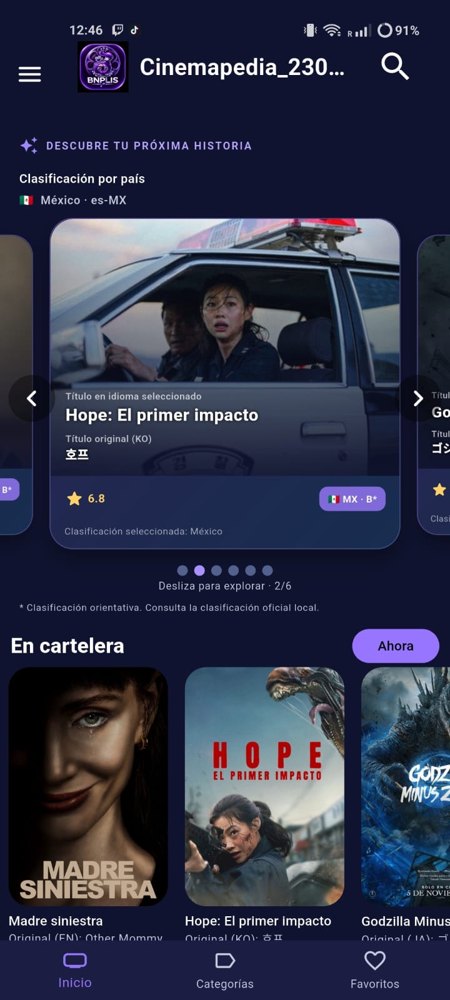 | 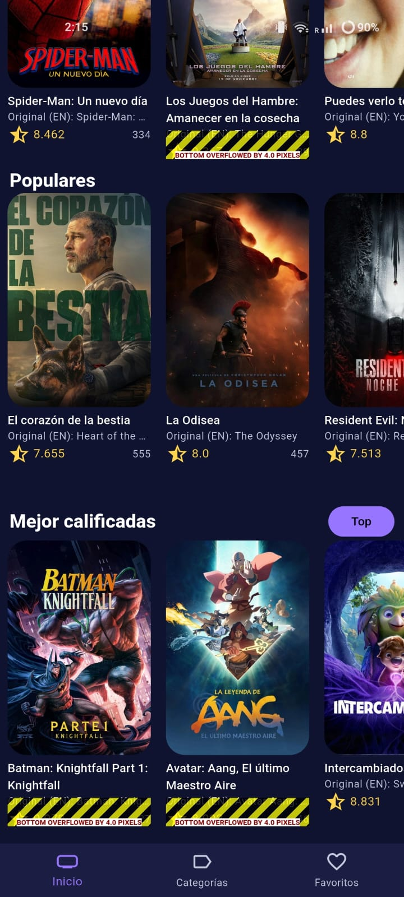 | 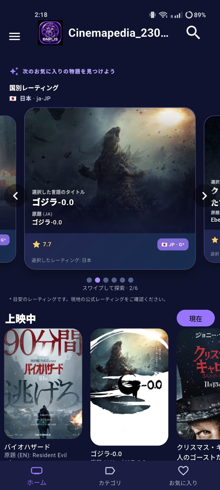 |

### Navegación y categorías

| Menú lateral | Categorías | Favoritos |
|---|---|---|
| 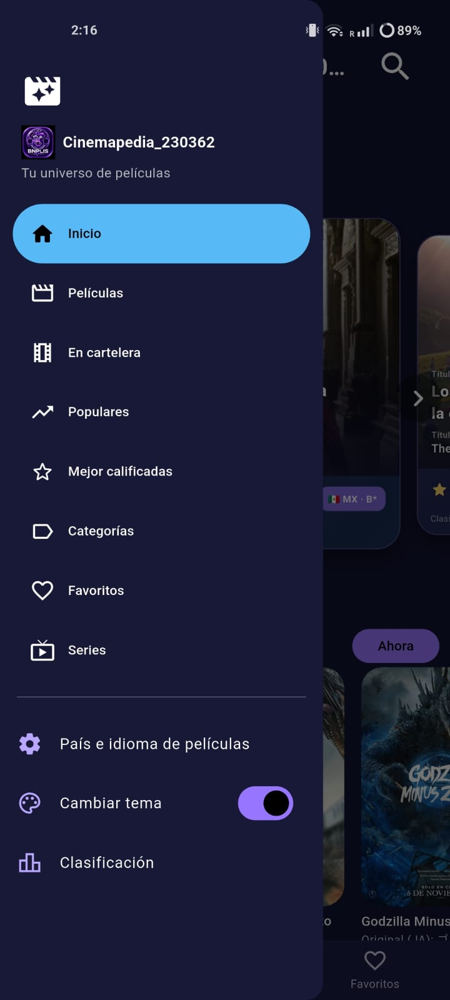 | 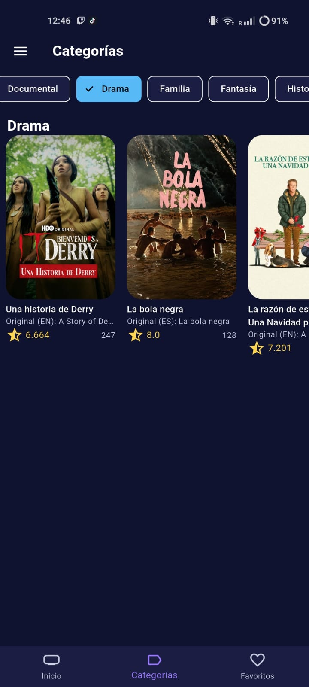 | 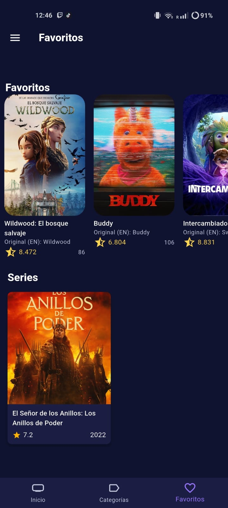 |

### Búsqueda

| Resultados de series | Resultados de películas |
|---|---|
| 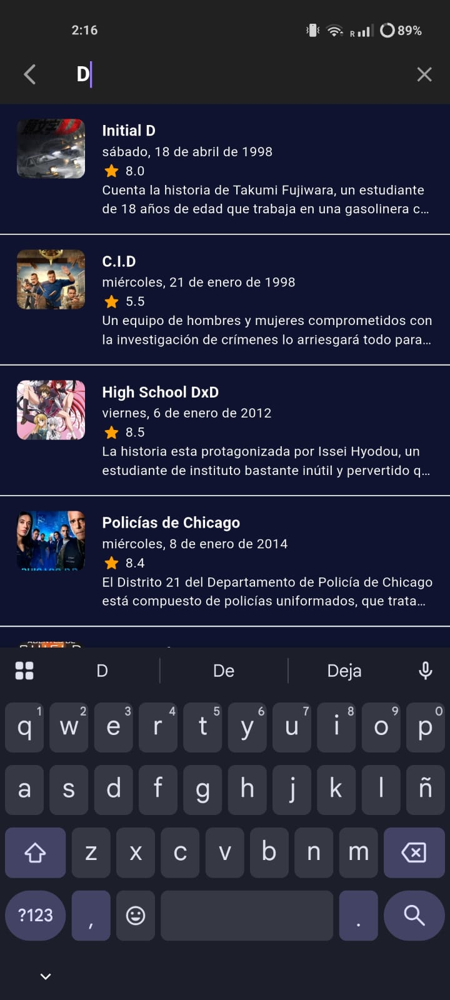 | 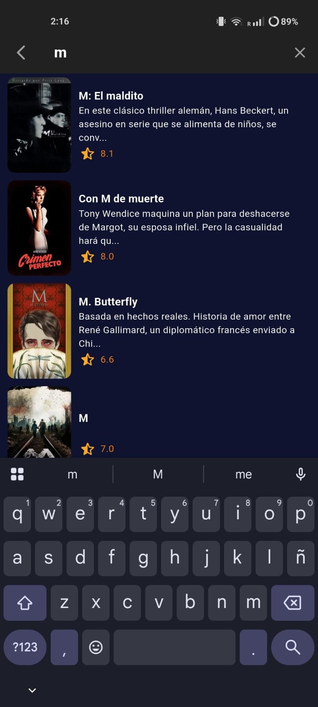 |

### Películas y detalles

| Detalle de Hope | Detalle de Ebenezer | Detalle de Godzilla Minus Zero |
|---|---|---|
| 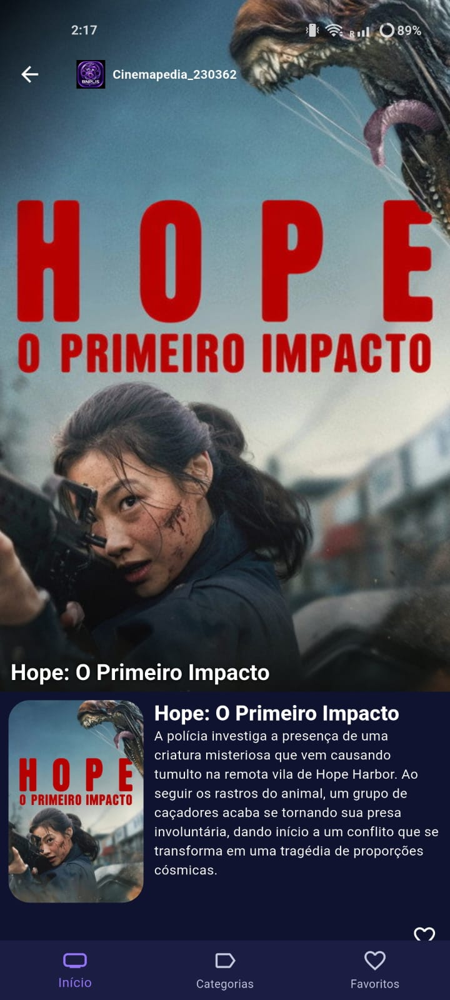 | 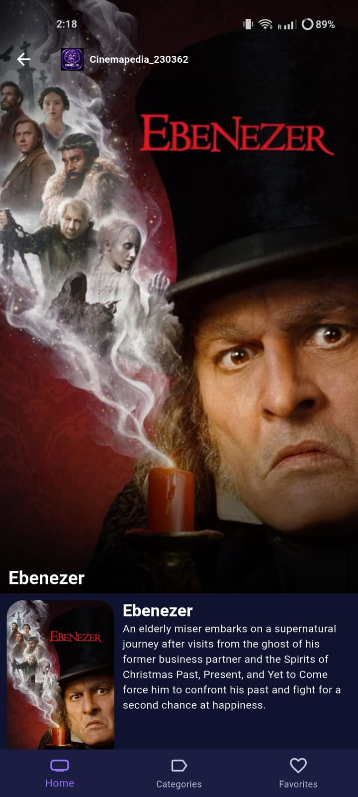 | 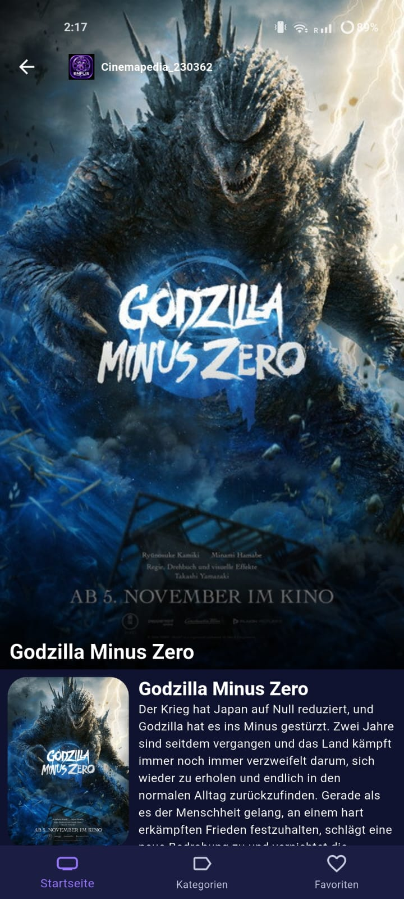 |

### Actores y reparto

| Detalle con información del reparto |  |  |
|---|---|---|
| 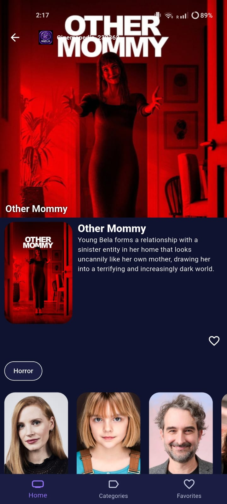 |  |  |

### Series y contenido adicional

| Detalle de Forgotten Island | Estado de carga |  |
|---|---|---|
| 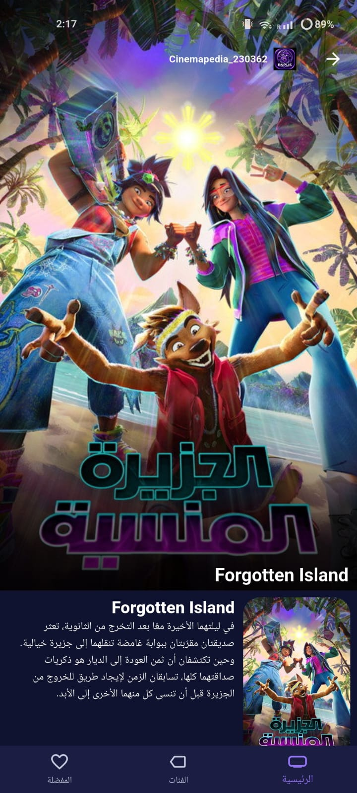 | 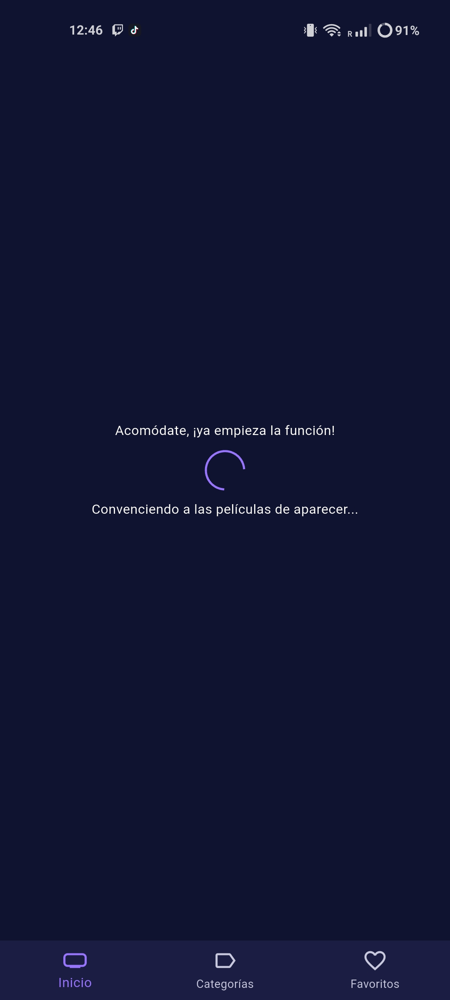 |  |

## Instalación y ejecución

### Requisitos previos

- Flutter SDK y Dart SDK compatibles con las restricciones declaradas en `pubspec.yaml`.
- Android Studio o Visual Studio Code.
- Emulador Android o dispositivo físico.
- Una API key de TMDB.

### Pasos

1. Clona o descomprime el proyecto y abre una terminal en la carpeta raíz de Cinemapedia.
2. Instala las dependencias:

   ```bash
   flutter pub get
   ```

3. Copia `.env.template` como `.env` en la raíz del proyecto y configura tu clave:

   ```env
   THE_MOVIEDB_KEY=TU_API_KEY
   ```

4. Ejecuta la aplicación:

   ```bash
   flutter run
   ```

Para generar un APK de producción, con `.env` configurado en la raíz:

```bash
flutter build apk --release
```

También se puede proporcionar `THE_MOVIEDB_KEY` durante la compilación con `--dart-define=THE_MOVIEDB_KEY=...`. No incluyas la clave en el código fuente ni en repositorios. La clave empaquetada en una aplicación cliente puede extraerse del APK; trátala como una credencial pública y restríngela o rótala desde TMDB cuando sea posible.

## Dependencias

Las dependencias se declaran en `pubspec.yaml`. Para instalarlas en el entorno local:

```bash
flutter pub get
```

Entre las dependencias principales están `flutter_riverpod`, `go_router`, `dio`, `flutter_dotenv`, `shared_preferences`, `intl`, `animate_do` y `card_swiper`. No se fija aquí una versión de Flutter o Dart distinta de la declarada por el proyecto.

## Cómo obtener la API key

1. Crea una cuenta en [The Movie Database](https://www.themoviedb.org/).
2. En la configuración de la cuenta, solicita una API key.
3. Configura la clave en el archivo `.env` siguiendo los pasos de instalación.

No subas `.env` a repositorios públicos. `.env.template` sirve como referencia y no contiene credenciales.

## Gestos y comportamiento del carrusel

- Deslizar horizontalmente permite recorrer las películas.
- Tocar una flecha avanza o retrocede una película; tocarla dos veces salta al final del carrusel o, si ya está al final, vuelve al inicio.
- Al llegar a la primera o última película se muestra el aviso correspondiente.
- Tocar una tarjeta abre el detalle de la película.
- El selector de país actualiza la bandera, el idioma y la región usados en las peticiones, y la referencia de clasificación de las tarjetas.
- El selector también cambia la locale de la interfaz y guarda el código del país con `shared_preferences`. La interfaz usa el idioma base del país (por ejemplo, `en-US` y `en-AU` usan inglés), mientras que las peticiones TMDB conservan el idioma y la región completos.

## Diagrama de arquitectura

[Consultar el diagrama interactivo de arquitectura de Cinemapedia](Practica06/Arquitectura/Arquitectura_de_Cinemapedia.html). El HTML es autocontenido y puede publicarse con GitHub Pages.

---

## Datos académicos

**Proyecto:** cinemapedia_230362  
**Alumna:** Brisa Nallely Garcia Gregorio  
**Matrícula:** 230362  
**Clave:** BNGG


